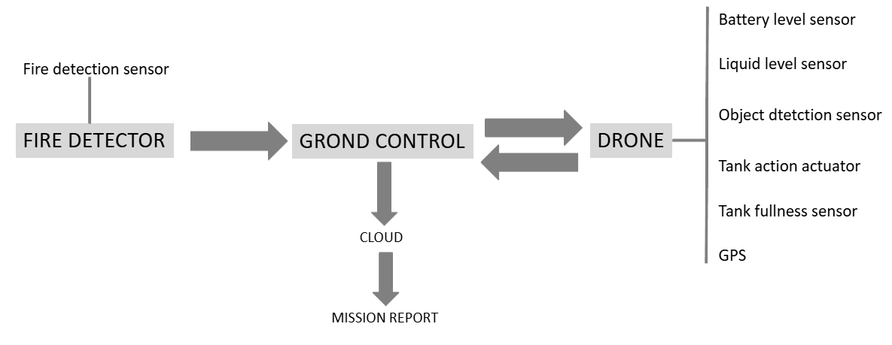
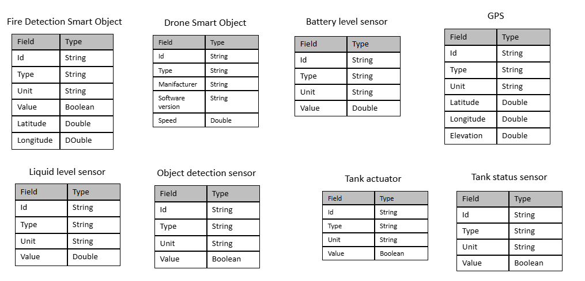
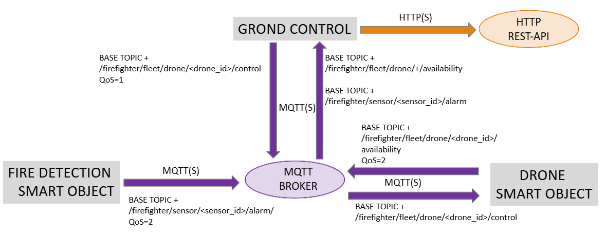
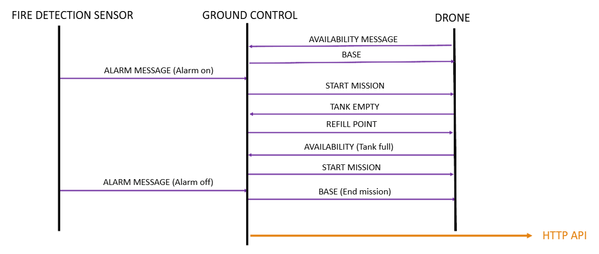

# Wildfire Detection and Autonomous Drone Response System

This project was implemented for an university course on Intelligent Internet of Things. It is a distributed IoT and simulation architecture built entirely in **Java**, designed to automate wildfire detection, coordinate emergency drone responses, manage resource constraints (water tanks), and log mission analytics to the cloud.

## System Overview

This project simulates a smart emergency response ecosystem. It bridges physical IoT edge nodes (sensors and drones) with a centralized coordination unit (ground station) and a remote cloud repository. The core objective is to minimize response time to wildfires through automated event-driven communication.

---

## Architectural Components & Responsibilities

### 1. Fire Sensors (IoT Edge Nodes)

- **Role:** Environmental monitoring and threat detection.
- **Properties:** Each sensor is instantiated with a fixed geographic position (latitude and longitude).
- **Behavior:** Continuously monitor their surroundings. Upon detecting a fire, they immediately generate an alarm payload containing their unique identifier and coordinate data, publishing it to an MQTT topic.

### 2. Ground Station (Central Coordinator)

- **Role:** The manager of the firefighting operations.
- **Behavior:**
  - Listens to incoming MQTT wildfire alerts from all active sensors.
  - Evaluates fleet availability and dispatches the drones toward the fire's coordinates.
  - Computes an algorithms to assign the nearest water refill station whenever a drone reports an empty tank.

### 3. Drones (Autonomous Responders)

- **Role:** Execution units tasked with navigation and fire suppression.
- **Properties:** Equipped with a water tank.
- **Behavior:**
  - Receive coordinates and move to fires locations.
  - Release water during firefighting operations.
  - Actively monitor tank levels and broadcast an empty-tank warning back to the Ground Station, pausing operations until refill coordinates are received.

### 4. Cloud Reporting Service

- **Role:** Long-term storage and data analytics.
- **Behavior:** Remains dormant during active operations. Upon mission conclusion, it acts as an HTTP server endpoint that receives a comprehensive JSON mission summary report from the Ground Station.

---

## Data Structures

The diagram below illustrates the core Java class structures and data models used across the system. It outlines all the entities used in this project.

---

## Workflow and Data Flow

The lifecycle of an emergency event flows through distinct, automated phases:

1. **Phase 1: Detection & Alerting (MQTT)**  
   A sensor detects an anomaly. It publishes an MQTT message (`firefighter/sensor/<sensor-id>/alarm`) containing its precise location coordinates.

2. **Phase 2: Coordination & Dispatch (MQTT)**  
   The Ground Station, subscribed to the alert topics, intercepts the message. It selects an idle drone and publishes a command (`firefighter/fleet/drone/<dropne-id>/control`) containing the target fire coordinates.

3. **Phase 3: Suppression & Resource Management (MQTT)**
   - The drone navigates to the target and release water contained in the tank.
   - If the tank reaches critical levels before the fire is extinguished, the drone publishes a refill request (``firefighter/fleet/drone/<dropne-id>/availability`).
   - The Ground Station calculates the closest water source based on spatial coordinates and sends back a coordinate update (`firefighter/fleet/drone/<dropne-id>/control`).
   - Once refilled, the drone resumes its mission or returns to base.

4. **Phase 4: Mission Conclusion & Cloud Reporting (HTTP - Dropwizard)**  
   Once all fires are extinguished and drones are secured, the Ground Station compiles an end-of-mission report (duration, resources used, fires handled) and pushes it via an **HTTP POST request** to the cloud backend.

---

## 📡 Communication Protocol Strategy

- **MQTT (Lightweight Publish-Subscribe):** Chosen for all intra-system telemetry and command signals between sensors, drones, and the ground station due to its low overhead, reliability, and real-time capability over unreliable wireless networks.
- **HTTP / REST:** Chosen for the final reporting phase.
